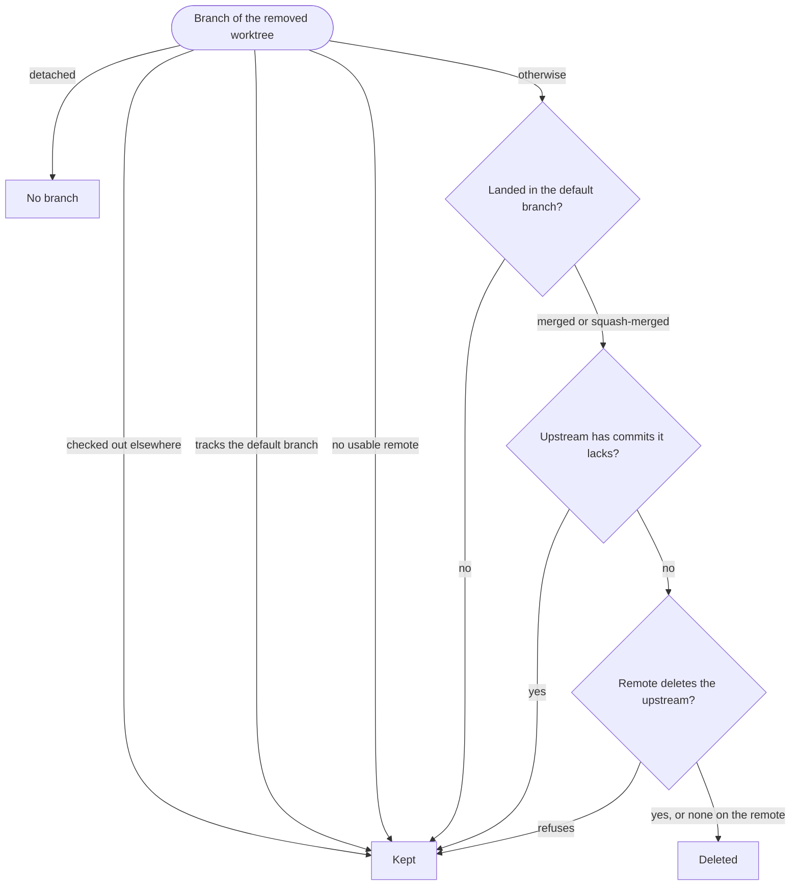

# agent-worktree

Task worktrees, so coding agents working in parallel never share a checkout: each task gets its own, set up and torn down by the project's own commands. agent-worktree never works out what a checkout needs: `agent-worktree install` writes the setup and teardown commands and the port count the project gives it into hooks, and agent-worktree runs those.

- `agent-worktree create <name>` makes a git worktree outside the repository, on a new branch cut from `origin`'s default branch as `origin` has it now, runs the project's setup hook in it, and prints its path.
- `agent-worktree remove <name>` runs the project's teardown hook, removes the worktree, and once its remote's default branch has the branch, deletes it locally and, when it was pushed with an upstream, on that remote. When the upstream holds a commit the branch lacks, it keeps both copies.
- The `cniska-worktree` Claude Code plugin sends Claude Code's own worktrees through the same commands.

## Install

agent-worktree runs on [Bun](https://bun.sh), which [mise](https://mise.jdx.dev) installs for it. With mise installed:

```bash
git clone https://github.com/cniska/agent-worktree.git
cd agent-worktree
mise trust && mise install
```

`mise install` installs Bun and the dependencies, and in the clone, never in a worktree, puts `agent-worktree` in `~/.bun/bin` with `bun link`, so removing a worktree never leaves the command pointing at a deleted checkout. Add that directory to your `PATH` if it is not there yet.

Then install the Claude Code plugin:

```bash
claude plugin install cniska-worktree@cniska
```

## Why

Two agents in one checkout overwrite each other's files, so parallel work needs a checkout per task. A bare `git worktree add` gives a checkout that is not ready to work in: no dependencies installed, no local config, nothing the project's tooling expects. When the work is done, whatever the worktree started outside its directory, such as a database or a simulator, is left running.

Claude Code makes worktrees of its own, for EnterWorktree and for subagents with worktree isolation, and does not run the project's own setup for them. It also repoints git's shared `core.hooksPath` when it does, so a `post-checkout` hook is not a reliable place for setup either. agent-worktree owns the whole lifecycle instead: it creates the worktree, runs the project's setup, records whether setup finished, and runs the teardown before the worktree goes.

## Where worktrees live

A task worktree lives at `${XDG_DATA_HOME:-~/.local/share}/agent-worktree/<project>-<hash>/<name>`, outside the primary checkout, so it does not pick up the primary's own config, such as its `mise.toml`. `<project>` is the primary checkout's directory name and `<hash>` is taken from its absolute path, so two clones with one name get their own directories. Run `agent-worktree path <name>` to find one. The record of which worktrees agent-worktree registered, and whether their setup finished, stays with the clone in `.git/agent-worktrees`; which worktree holds which port block is kept for the whole machine in `${XDG_DATA_HOME:-~/.local/share}/agent-worktree/ports`.

Releases before this one made worktrees at `<primary>/.claude/worktrees/<name>`. `ls` lists a worktree agent-worktree registered there as `legacy`; `create`, `init`, `remove` and the `WorktreeRemove` hook refuse it, naming the two ways out: move it to its new path with `git worktree move` and run `agent-worktree init` in it, or remove it with `git worktree remove` and run `agent-worktree prune`, which runs its teardown; `prune` leaves it registered and runs no teardown for it while it is still there. A worktree another tool made there, which agent-worktree never registered, is not its own: `ls` leaves it out and no command touches it.

## Project contract

Any git repository works as it is. A project whose worktrees need more than a checkout installs its own commands as hooks, from its primary checkout:

```bash
agent-worktree install --setup "mise install && pnpm install --frozen-lockfile" --teardown "docker compose down -v" --ports 20
```

Each option is optional: install writes `.worktree-hooks/setup`, `.worktree-hooks/teardown` and `.worktree-hooks/ports` for the options given, prints their paths, and leaves the hooks it is not given as they are, so a later `install --teardown "<command>"` changes only the teardown. A project with no setup hook gets no setup, one with no teardown hook no teardown, and one with no ports hook no ports. Commit `.worktree-hooks/`; delete a hook to drop it. install never works out a command, and never stages or commits. [`SPEC.md`](SPEC.md) states what each hook gets and when it runs (§2.8), and everything else that must hold.

A setup or teardown hook is plain shell that holds its command as `command='<command>'`, so the command shows in the diff, and runs it with `sh -ec`. Setup runs in the worktree being set up, teardown in the primary checkout, since the worktree may already be gone. Both run on every resume and retry, so a command must be safe to run again.

### Only in your clone

In a project whose other developers do not use agent-worktree, keep the hooks out of the repository with `--local`:

```bash
agent-worktree install --local --setup "pnpm install --frozen-lockfile" --ports 10
```

`--local` writes the same hooks into `worktree-hooks/` in the clone's git directory (`git rev-parse --git-common-dir`), never into the tree, so nothing is committed and every worktree of the clone shares them. Where a clone has both, each local hook takes the place of the committed one of the same name, and a hook it lacks locally is still read from the checkout. For such a project, enable the plugin in the project's `.claude/settings.local.json` rather than its shared `.claude/settings.json`, so it stays yours too.

```json
{ "enabledPlugins": { "cniska-worktree@cniska": true } }
```

### Ports

Ports are an add-on. A project whose worktrees need ports of their own, such as for a stack each worktree runs, installs how many with `--ports`, one whole number from 1 to 1000, which becomes `.worktree-hooks/ports`:

```text
20
```

agent-worktree reads that hook, never runs it, in the checkout being set up, and a project without one gets no ports and never waits for any. Each task worktree of a project that asks gets its own block, the lowest free one made of enough consecutive 10-port units from 24000 to 24999 to hold the number asked for, and its hooks get the first port as `WORKTREE_PORT`; the project's ports run from there. A block is never worked out from the name, so two worktrees never share one, and a unit where another program already listens is skipped. agent-worktree finds a listener by connecting to the port on `127.0.0.1` and `::1`, which a program listening on every address accepts too; it never binds a port to probe it, since binding `0.0.0.0` or `::` can raise the macOS firewall prompt on every `create`, in front of an agent nobody is watching. Blocks are shared across every clone on the machine; `ls` shows each worktree's, `remove` frees it, and `prune` frees those of worktrees removed some other way, even in a clone since deleted. `create` and `init` take such a block over themselves when they reach it, running a gone worktree's teardown first as `prune` would. With no block free, they first remove the worktrees whose branch landed, as `prune` does, before refusing. The primary checkout gets no block and keeps the project's default ports, so a plain clone, such as CI's, does too. `init` gives a block to a worktree an earlier release made, resizes one whose request changed, and frees one whose project no longer asks.

[`examples/docker-compose`](examples/docker-compose) gives each worktree its own Docker Compose stack on its own ports, with the hooks `install --setup scripts/stack-env.sh --teardown scripts/stack-down.sh --ports 2` wrote.

### Without the CLI

The hooks need nothing of agent-worktree, so a developer without it runs them by hand from the primary checkout, setting any `WORKTREE_*` variable the commands read (§2.8), with a free port for `WORKTREE_PORT`, and skipping a hook the project lacks:

```bash
git worktree add ../<name>
(cd ../<name> && .worktree-hooks/setup)
WORKTREE_NAME=<name> .worktree-hooks/teardown
git worktree remove ../<name>
```

## Commands

| Command | Does |
| --- | --- |
| `agent-worktree create [--from <ref>] <name>` | Create the worktree on branch `<name>`, as [Where `create` cuts a branch](#where-create-cuts-a-branch) says, run setup, print the path. Rerun to resume a failed setup. |
| `agent-worktree init` | Run setup in the current checkout, primary or task worktree. |
| `agent-worktree remove [--force] <name>` | Run teardown and remove the worktree, then settle its branch as [How `remove` settles a branch](#how-remove-settles-a-branch) says. Without `--force` a dirty worktree, one with submodules or a failed teardown refuses; a locked worktree always does. |
| `agent-worktree prune` | Prune git's stale worktree entries, tear down every worktree that is gone but still registered, and remove every clean worktree whose pushed branch landed, other than the one it runs in, settling each one's branch as `remove` does; refuses with the names whose teardown failed. |
| `agent-worktree ls` | One line per worktree: name, state, branch, port block, path. |
| `agent-worktree path <name>` | Print the worktree's path. |
| `agent-worktree hook` | The plugin's `WorktreeCreate` and `WorktreeRemove` entry: reads the event from stdin. |
| `agent-worktree install [--local] [--setup <command>] [--teardown <command>] [--ports <n>]` | Write the hook each option names into `.worktree-hooks/`, or with `--local` into the clone's git directory, leaving the others as they are, and print each path. |
| `agent-worktree --version` | Print the version alone on one line. |

Results go to stdout. A refusal goes to stderr with the act that resolves it, and exits 1; a usage error exits 2.

### Where `create` cuts a branch

An existing branch `<name>` is checked out. A new one is cut with no upstream, so `remove` and `prune` settle it as `create` made it:

- Without `--from`, from `origin`'s default branch, which `create` reads and fetches first, as `remove` does. With no `origin`, or one with no default branch, it is cut from the primary's HEAD, with a note on stderr. When `origin` cannot be reached within 60 seconds, `create` refuses and names `--from HEAD`, rather than cut from a base that may trail.
- With `--from <ref>`, from the commit `<ref>` names in the checkout `create` runs in, without reaching a remote. `--from` with an existing branch refuses, and on a worktree `create` already made it is ignored, so a rerun resumes a failed setup.

### How `remove` settles a branch

Once the worktree is gone, `remove` settles its branch against the branch's remote: its upstream's remote, else `origin`. Once per remote in a command, it asks the remote for its default branch and its branches and fetches that default branch. It decides in this order, and the first case that holds settles the branch:

1. A detached worktree has no branch, and `remove` prints `detached`.
2. A branch checked out in another worktree is kept.
3. A branch whose remote does not exist, cannot be reached or has no default branch is kept.
4. A branch that tracks the remote's default branch itself is kept.
5. A branch that has not landed is kept. It has landed when the default branch has its tip (merged), or when its upstream is gone from the remote and its whole change since the merge base matches one commit already in the default branch (squash-merged), as after a squash merge whose host deleted the branch.
6. A landed branch whose upstream holds commits the branch lacks is kept.
7. Any other landed branch is deleted. When its upstream is still on the remote, `remove` deletes that first, and when the remote refuses, the branch is kept. An upstream already gone is no error.

`--force` never changes which branch is deleted.



`remove` prints the outcome on one line, the reason after `kept, `:

```text
branch fix-login deleted, merged into origin/main, and origin/fix-login deleted
branch fix-login deleted, squash-merged into origin/main
branch fix-login kept, not merged into origin/main
branch fix-login kept, origin/fix-login has commits it lacks
branch fix-login kept, checked out at /home/dev/other-checkout
```

## Claude Code plugin

The `cniska-worktree` plugin, in the `cniska` marketplace, does two things:

- Whenever a session starts, resumes, clears or compacts, it adds a short note, `plugin/hooks/note.md`, telling the agent to create worktrees with `create` and remove them with `remove`.
- Its `WorktreeCreate` and `WorktreeRemove` hooks send EnterWorktree and a subagent's worktree isolation through the same commands.

Claude Code's ExitWorktree refuses `action: "remove"` on every worktree a hook created, clean or not ([anthropics/claude-code#100761](https://github.com/anthropics/claude-code/issues/100761)). The note therefore tells the agent to exit with `keep` and remove with `agent-worktree remove`, which keeps the dirty-tree refusal that `discard_changes: true` would bypass.

The plugin brings neither Bun nor the CLI. Install the CLI first: with the plugin installed and no CLI on `PATH`, every Claude Code worktree fails to create.

## Development

### Setup

```bash
mise trust && mise install
bin/agent-worktree create <name>
```

- `mise install` sets up the clone as [Install](#install) says, and the `bun install` its postinstall runs calls the `prepare` script, which points `core.hooksPath` at `.githooks/`.
- `bin/agent-worktree create <name>` makes a task worktree and runs the repository's own `.worktree-hooks/setup` in it, which installs the same way without linking the CLI.
- `.githooks/` holds the commit-subject, format and no-comments gates.

### Checks

- `bun run check` runs the lint, the typecheck, knip (an export, file or dependency nothing uses) and the tests, and `.githooks/pre-commit.d/check` runs it before each commit.
- `bun run acceptance` proves the criteria in [`SPEC.md`](SPEC.md) through the CLI alone, as [`AGENTS.md`](AGENTS.md) describes. Each test gets 20 seconds rather than Bun's default 5, since one drives git and the CLI dozens of times and a `create` with a remote also reads and fetches it.
- `scripts/build-compiled.sh <outfile>` compiles the CLI into one executable that needs no Bun, the binary a release ships.
- `scripts/release.sh patch|minor|major` bumps the version and tags it; `.github/workflows/release.yml` builds the tag into a GitHub release, the npm packages and a Homebrew repin, as [Releasing](docs/releasing.md) says.
- `bun run format` formats `src/`, `acceptance/` and `scripts/` with Biome, and the format gate runs it with the linter off before each commit and stages what it changes in the staged files.
- `npm/agent-worktree` is the npm package's launcher, a POSIX shell script `scripts/build-npm.ts` fills with the release builds; `scripts/launcher.test.ts`, in the check, runs it over the layouts `npm` and `bun` install, with no runtime on `PATH`.
- `.github/workflows/check.yml` runs the check and the acceptance suite on each push and pull request, and `commits.yml`, `format.yml` and `no-comments.yml` run the gates.

### Layout

- The plugin lives in `plugin/`, apart from the repository root, so the CLI's `bin/` stays off the `PATH` Claude Code gives a plugin.
- [`src/README.md`](src/README.md) maps the modules and the boundaries between them.

### Rules

[`AGENTS.md`](AGENTS.md) holds the repository's rules, and [`SPEC.md`](SPEC.md) states what must hold.
